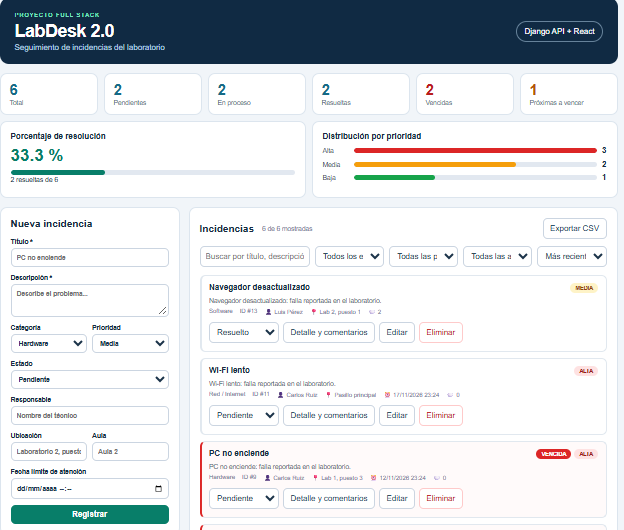
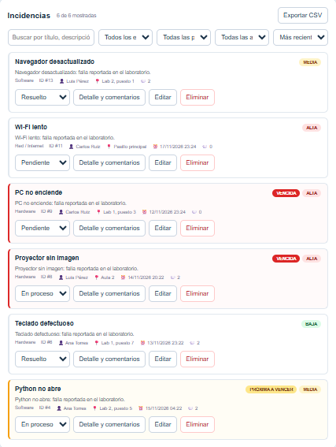
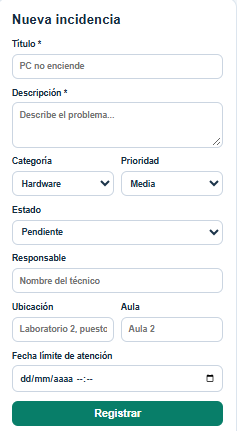
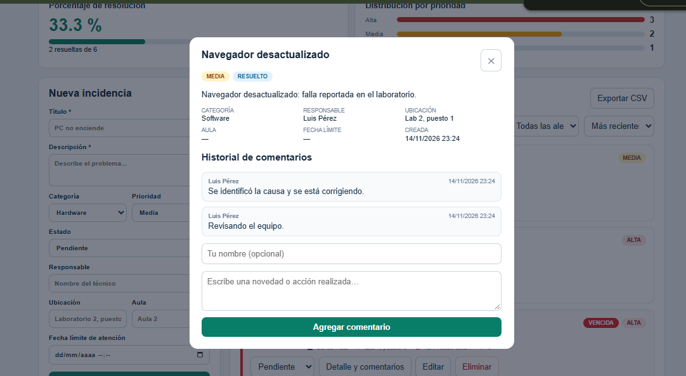

# LabDesk 2.0 — Seguimiento de incidencias (Django REST + React)

Continuación del proyecto LabDesk. Cada incidencia tiene **responsable, ubicación y fecha límite**,
un **historial de comentarios**, **alertas de vencimiento** y un **dashboard** calculado por Django.
Todo se guarda en SQLite a través de la API.

> Solo para desarrollo local y aprendizaje (`DEBUG=True`, sin autenticación). No publicar así.

## Requisitos

- Python 3.10 o superior y pip
- Node.js 20.19+ o 22.12+ y npm
- Git

## Instalación y ejecución

**Terminal A — backend**

```powershell
cd backend
python -m venv .venv
.\.venv\Scripts\Activate.ps1          # macOS/Linux: source .venv/bin/activate
python -m pip install -r requirements.txt
python manage.py migrate
python manage.py runserver
```

API: http://127.0.0.1:8000/api/incidencias/

**Terminal B — frontend**

```powershell
cd frontend
npm install
npm run dev
```

Web: http://127.0.0.1:5173/

Deja ambas terminales encendidas.

## Datos de prueba

La base de datos (`db.sqlite3`) no se sube al repositorio. Para cargar incidencias de ejemplo
(con vencidas, próximas a vencer, resueltas y comentarios), con el entorno activo y dentro de `backend`:

```powershell
python manage.py shell -c "exec(open('seed.py', encoding='utf-8').read())"
```

Ejecútalo una sola vez, o los datos se duplican. También puedes crear incidencias desde el formulario.

## Endpoints

| Método | URL | Descripción |
|---|---|---|
| GET | /api/incidencias/ | Listar incidencias (incluye `alerta` y `total_comentarios`) |
| POST | /api/incidencias/ | Crear |
| PUT | /api/incidencias/{id}/ | Editar todos los campos |
| PATCH | /api/incidencias/{id}/ | Cambiar solo el estado u otro campo |
| DELETE | /api/incidencias/{id}/ | Eliminar (borra también sus comentarios) |
| GET | /api/incidencias/{id}/comentarios/ | Historial de comentarios, el más reciente primero |
| POST | /api/incidencias/{id}/comentarios/ | Agregar comentario (`autor` opcional, `texto` obligatorio) |
| GET | /api/incidencias/estadisticas/ | Indicadores del dashboard |

Campos nuevos de la incidencia: `responsable`, `ubicacion` (texto) y `fecha_limite` (fecha y hora, opcional).

## Reglas de negocio

- **Vencida:** `fecha_limite` ya pasó y el estado **no** es resuelto.
- **Próxima a vencer:** vence dentro de las próximas 24 horas y **no** está resuelta.
- Una incidencia **resuelta nunca** se muestra como vencida ni próxima a vencer.
- **Porcentaje de resolución** = (resueltas / total) × 100, redondeado a 1 decimal; si el total es 0 muestra 0 %.

La regla vive en un solo lugar (`Incidencia.alerta` en `models.py`) y la usan tanto la lista como el dashboard.

## Estructura

```
backend/incidencias/
  models.py        Incidencia (+ alerta) y Comentario (ForeignKey)
  serializers.py   Validaciones de campos obligatorios
  views.py         CRUD + /comentarios/ + /estadisticas/
  seed.py          (en backend/) datos de prueba
frontend/src/
  api.js           Llamadas a Django y manejo de errores
  utils.js         Etiquetas, fechas y exportación CSV
  App.jsx          Estado general, filtros y orden
  components/      Dashboard, Formulario, Tarjeta, Detalle con comentarios
```

## Cómo probar

1. Carga los datos de prueba o crea al menos cinco incidencias con distintos estados y prioridades.
2. Una con fecha límite pasada (se ve **Vencida** en rojo) y otra dentro de unas horas (**Próxima a vencer**).
3. Cámbiala a **Resuelto**: la alerta desaparece y el dashboard se actualiza.
4. Abre **Detalle y comentarios**, agrega comentarios y comprueba que aparecen con fecha y hora.
5. Recarga con F5: todo permanece (está en SQLite).
6. Guarda con el título vacío: el formulario muestra el error y no envía.
7. Apaga Django: la página muestra un error con el botón **Reintentar**.

## Evidencias

### Capturas

**Formulario** (responsable, ubicación y fecha límite)



**Historial de comentarios**



**Alertas de vencimiento**



**Dashboard**



### Video de demostración (3 a 5 minutos)

ENLACE-DEL-VIDEO

## Extras incluidos

Filtro por alertas, orden por fecha límite, exportación a CSV, campo `aula` y vista responsive.

## Seguridad

No subas contraseñas, tokens, `.venv` ni `node_modules`. El `.gitignore` ya los excluye, junto con `db.sqlite3`.